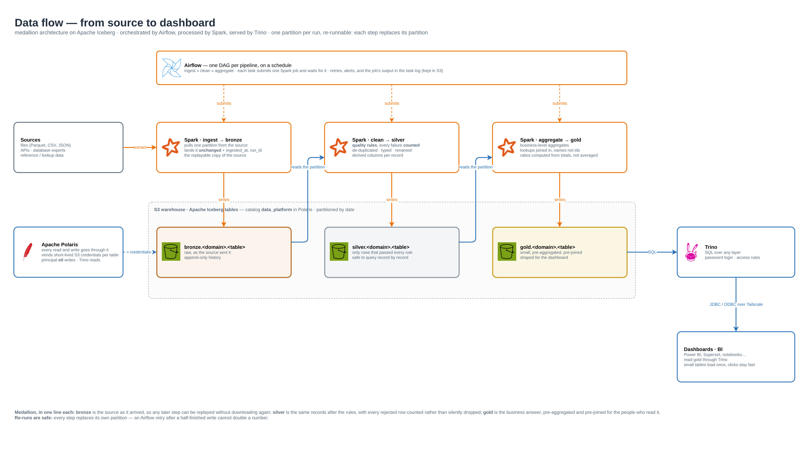
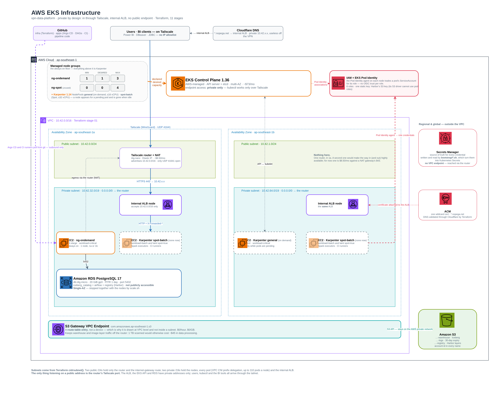
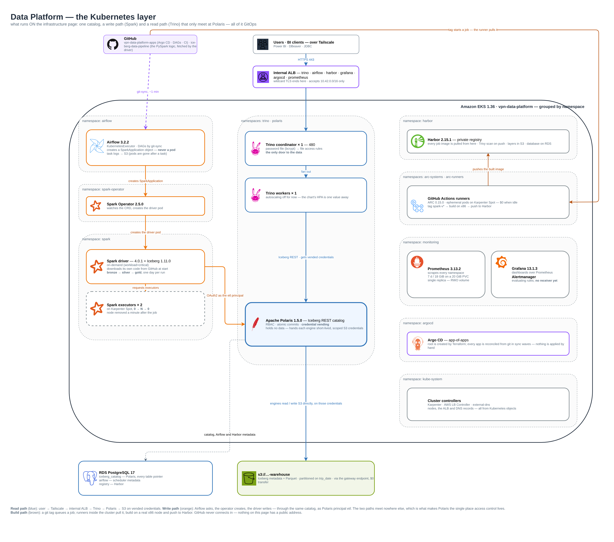

# vpn_data_platform

**An open-source lakehouse on Amazon EKS that has no public endpoint at all.**

A personal project to run a complete open-source data stack end to end:
Apache Iceberg tables in S3, an Apache Polaris catalog, Spark for writing,
Trino for reading, Airflow for orchestration, plus the platform around them —
a private registry, GitOps, CI, autoscaling and monitoring. Everyone reaches
it over Tailscale; nothing listens on the internet except the VPN port.

Infrastructure is this repository (Terraform, 11 stages). What runs inside
the cluster is **[vpn-data-platform-apps](https://github.com/nopega/vpn-data-platform-apps)**,
reconciled by Argo CD.



## Highlights

### 🔒 Private by design
- **No public endpoint.** One internal Application Load Balancer serves every
  web UI and Trino; the EKS API is private; RDS is in-VPC only.
- **Tailscale instead of an IP allowlist.** Access is tied to a person and a
  device, not a home address that changes. Adding a user is one invitation.
- **Real hostnames and TLS anyway.** A wildcard ACM certificate and
  external-dns publish `*.nopega.net` — the names resolve to private
  addresses, so they only work on the tailnet.

### 🧊 Open lakehouse on Apache Iceberg
- **One catalog, two engines.** Spark writes and Trino reads the same Iceberg
  tables through the Polaris REST catalog. Neither engine is tied to the other,
  or to AWS.
- **Credential vending.** Engines hold no bucket-wide S3 access. Polaris hands
  out short-lived credentials scoped to the table being read or written, and
  Spark writes as a dedicated `etl` principal.
- **Medallion layout that is also the policy.** `bronze` → `silver` → `gold`,
  with the data category in the path, so retention and deletion rules key on
  where a table lives ([DATA_TIER.md](docs/DATA_TIER.md)).

### 🔁 Pipelines that are safe to re-run
- **Airflow 3 with KubernetesExecutor.** Every task is its own pod, every
  transformation is a `SparkApplication` — no Celery broker, no idle workers.
- **One partition per run.** Each step replaces its own partition, so a retry
  after a half-finished write cannot double a number.
- **Lineage on every row.** Bronze carries `_ingested_at`, `_source_file` and
  `_run_id`, so a gold number traces back to the file and the job behind it.
- **DAGs from git.** git-sync pulls DAGs from the apps repository; pipeline
  code is fetched by the Spark driver at start.

### 🚀 GitOps and CI, all inside the VPC
- **Argo CD app-of-apps.** Nothing is `kubectl apply`'d by hand; a rollback is
  a `git revert`.
- **Tag to image in one step.** Pushing a `spark-v*` git tag starts a GitHub
  Actions job on self-hosted runners **inside the cluster** (Actions Runner
  Controller), which builds the image and pushes it to Harbor.
- **Private registry.** Harbor stores images in S3; Spark pulls with a
  read-only robot account and CI pushes with its own.

### 🪪 No static keys in pods
- **EKS Pod Identity** for every workload that touches AWS — six roles, each
  scoped to what it needs. The one exception (Harbor's S3 driver) is a
  single-bucket key, documented.
- **Secrets generated, never typed.** `bootstrap/*.sh` generates every
  credential, stores it in AWS Secrets Manager, and writes it into the cluster.
  None is in git or shell history.
- **Least privilege for people too.** BI accounts read `gold` only; one
  operator account can write ([DATA_GOVERNANCE.md](docs/DATA_GOVERNANCE.md)).

### 💸 Cost-aware, and parkable
- **Karpenter + Spot at zero.** Spark executors and CI runners get Spot nodes
  for the minutes a job runs, then the nodes are gone.
- **Small fixed costs.** The Tailscale router doubles as the NAT (~\$8/month
  instead of a NAT gateway), an S3 gateway endpoint keeps data traffic free,
  and every hostname shares one load balancer.
- **Park it overnight.** `scripts/scale.sh down` takes it from about
  \$9.7/day to about \$3.8/day; `up` brings everything back from git
  ([COST.md](docs/COST.md)).

### 📈 Observable
- Prometheus and Grafana cover the cluster, the nodes, Trino and Airflow
  (through StatsD), with 7 days / 18 GiB of local retention.

## Architecture

### Infrastructure — AWS, private by design


### Data platform — what runs on Kubernetes
Read path (blue) and write path (orange) meet only at Polaris; the build path
(brown) runs from a git tag to Harbor without anything connecting in.



All three pages are in [`docs/diagrams/vpn_data_platform.drawio`](docs/diagrams/vpn_data_platform.drawio)
— open it in [draw.io](https://app.diagrams.net/) to edit.

## Stack

| Layer | Component |
|---|---|
| Table format · catalog | Apache Iceberg 1.11.0 · Apache Polaris 1.5.0 |
| Processing · query | Apache Spark 4.0.1 (Kubeflow Spark Operator 2.5.0) · Trino 480 |
| Orchestration | Apache Airflow 3.2.2, KubernetesExecutor |
| Registry · CI | Harbor 2.15.1 · GitHub Actions on Actions Runner Controller 0.15.0 |
| Delivery · scaling | Argo CD · Karpenter 1.14.1 |
| Monitoring | Prometheus 3.13.2 · Grafana 13.1.3 · Alertmanager |
| AWS | EKS 1.36 · S3 · RDS PostgreSQL 17 · ALB · ACM · Secrets Manager |
| Network · infrastructure as code | Tailscale · Terraform |

Every version, why it was chosen, and how the versions constrain each other:
[COMPONENTS.md](docs/COMPONENTS.md).

## Documentation

| Document | What it covers |
|---|---|
| [COMPONENTS.md](docs/COMPONENTS.md) | every component, version compatibility, why this stack, planned upgrades |
| [DATA_TIER.md](docs/DATA_TIER.md) | buckets, warehouse layout, data categories, storage tiers and retention |
| [DATA_GOVERNANCE.md](docs/DATA_GOVERNANCE.md) | network, access control, Pod Identity, secrets, lineage — and the gaps |
| [COST.md](docs/COST.md) | running and parked cost, and every decision made for money |
| [REBUILD.md](docs/REBUILD.md) | park vs destroy, tear-down order, and rebuilding from nothing |
| [BACKLOG.md](BACKLOG.md) | known gaps and what is next |
| [bootstrap/README.md](bootstrap/README.md) | one-time secret and database steps, and their order |

## Repository layout

```
terraform/   11 stages, each applied on its own
bootstrap/   one-time secrets and database setup per component
scripts/     scale.sh — park and unpark the platform
docs/        the documents above and the diagrams
```

| Stage | Creates |
|---|---|
| `01_vpc` | VPC `10.42.0.0/16` in 2 zones, subnets, S3 gateway endpoint |
| `02_tailscale_router` | `t4g.nano` Tailscale subnet router, also the NAT for private subnets |
| `03_eks` | EKS 1.36 with a private API endpoint, one `t3.xlarge` system node |
| `04_ingress` | wildcard certificate, AWS Load Balancer Controller, external-dns |
| `05_argocd` | Argo CD and the root Application that watches the apps repository |
| `06_data_foundation` | warehouse and logs buckets, RDS PostgreSQL 17, Polaris IAM roles |
| `07_karpenter` | Karpenter controller, Spot interruption queue (NodePools live in the apps repo) |
| `08_registry` | Harbor's S3 bucket and scoped IAM user |
| `09_spark` | Spark Pod Identity role (event logs only) |
| `10_airflow` | Airflow Pod Identity role (task logs only) |
| `11_ci` | Actions Runner Controller and the runner scale set |

## Running it

```bash
# each stage, in order
cd terraform/01_vpc
terraform init && terraform apply

# then the matching bootstrap script, when bootstrap/README.md says so
./bootstrap/polaris.sh

# day to day
./scripts/scale.sh down     # park: no worker nodes, RDS stopped
./scripts/scale.sh up       # back: nodes, RDS, Argo CD restores the rest
./scripts/scale.sh status
```

Tailscale must be connected for `kubectl`, the bootstrap scripts and every UI.

**Tear down** in reverse order, 11 back to 01 — step by step in [REBUILD.md](docs/REBUILD.md). Before `04_ingress`, delete every
Ingress (or the ALB is orphaned); before `07_karpenter`, let Karpenter remove
its own nodes.
